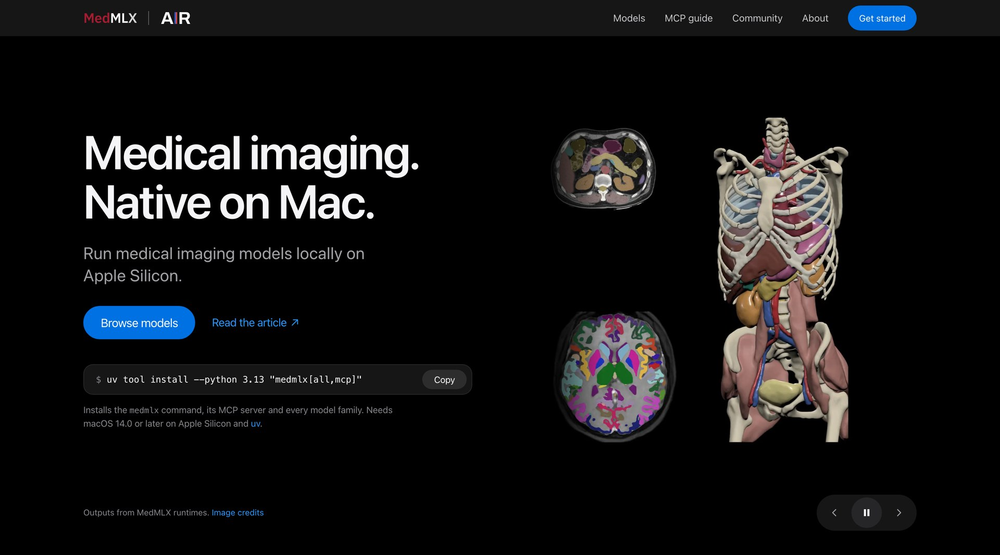

<div align="center">

# medmlx.org

The website for [MedMLX](https://github.com/MedMLX/medmlx): medical imaging models that run natively on Apple Silicon.

[](https://medmlx.org)
[](https://github.com/MedMLX/medmlx.org/blob/main/LICENSE)

[Website](https://medmlx.org) · [MedMLX](https://github.com/MedMLX/medmlx) · [Report a site problem](https://github.com/MedMLX/medmlx.org/issues/new/choose)



</div>

The site is static HTML, CSS and JavaScript with no build framework. It lists every
public MedMLX runtime with its install command, inputs, outputs, weights and peak
memory, taken from each package's released documentation.

## Preview

Serving the site needs only Python 3:

```sh
make serve
```

Then open <http://localhost:4173>. Set `PORT=8000` to use another port.

## Layout

| Path | Contents |
| :--- | :--- |
| `site/index.html`, `site/styles.css` | Page shell and styles |
| `site/render.js` | Renders every page without a DOM |
| `site/app.js` | Browser behavior only |
| `site/models.js`, `site/model-cards.js` | Model catalog and model pages |
| `site/releases.js` | Reviewed package versions and shared install commands |
| `site/assets/` | Images, video, fonts and brand files |
| `docs/hero/` | Scripts that render the site's images and videos from published runtime outputs |
| `devtools/` | Tests, release checks and the static export |

## Checks

`make env` creates the locked Python and Node environment once.

| Command | Checks |
| :--- | :--- |
| `make test` | Hermetic regression tests |
| `make release-check` | Every listed release against PyPI, its tagged GitHub source and Hugging Face: versions, install lines, examples, weight revisions, sizes and peak memory |
| `make qa` | Lint, type checks, local asset checks and the release check |
| `make pages` | Verifies the releases, then writes the prerendered export to `dist/pages/` |

`make release-check` needs network access. A new package release is listed by
reviewing its tag, updating `site/releases.js` and any changed examples, then running
`make release-check`.

## License

[Apache-2.0](https://github.com/MedMLX/medmlx.org/blob/main/LICENSE). Fonts, brand assets and imaging data keep their own terms; see [third-party notices](https://github.com/MedMLX/medmlx.org/blob/main/THIRD_PARTY_NOTICES.md).
